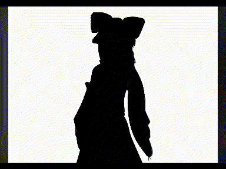

# text video converter
convert coloured videos to those made up of symbols. 

# usage
there is a five-second example file named `example.gif` included that can be used for testing.



**running `main.py`**:
* select file in some directory through pop-up window;
* view new file saved to that directory.

**running `convert.py` through shell**:
* use `-h` or `--help` flag to check usage,
* or include required positional argument as input filepath
* where `-o` or `--output` would be the optional argument for output filepath.
```
python convert.py [-h] [-o OUTPUT_FILEPATH] INPUT_FILEPATH
```

## dependencies
in `requirements.txt`. `pygame-ce` and `opencv-python`, where `numpy` is also a strict dependency of the latter.

## failure viewing
due to the nature of how `opencv-python` encodes videos, the output might not be able to be successfully displayed everywhere.

# config
there are certain limitations and other values set, but they are mostly arbitrary. for example, there is an option to process less symbols or pixels per frame, but it can be increased for clarity or further decreased for processing speed.